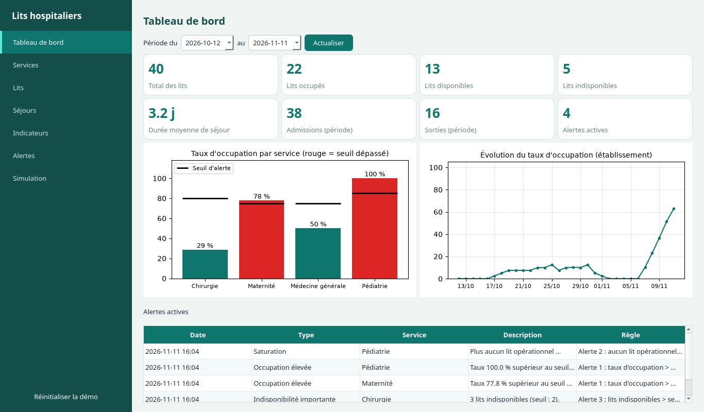
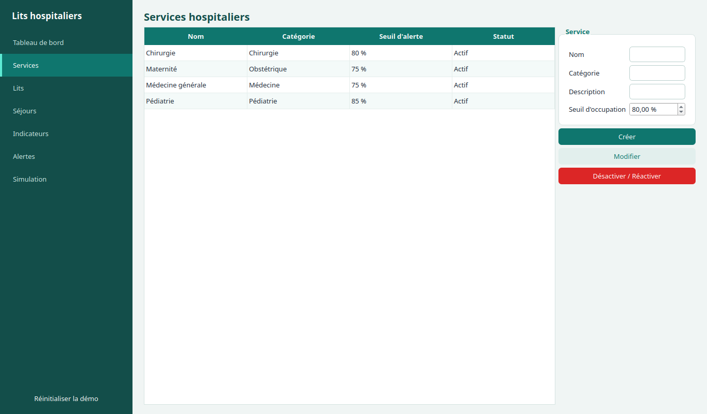
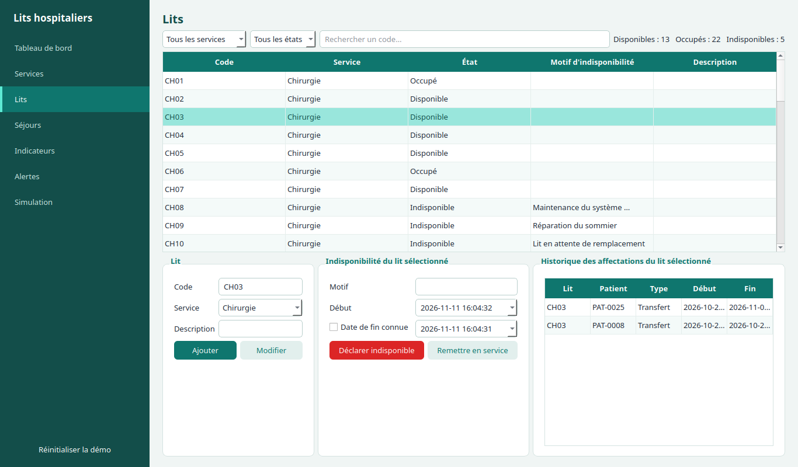
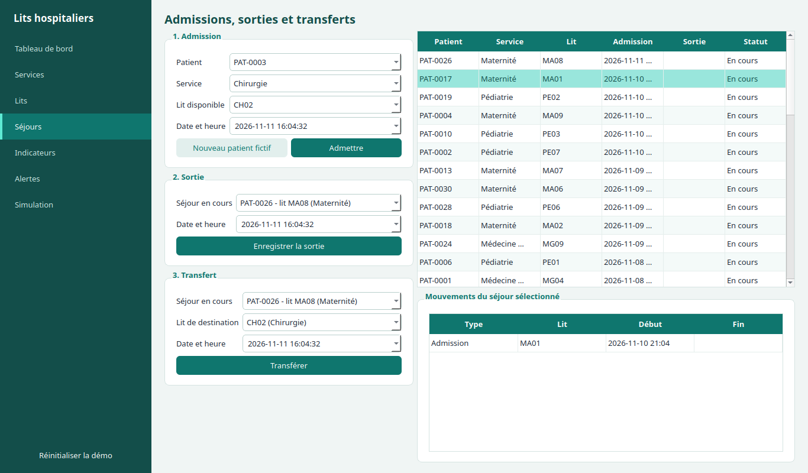
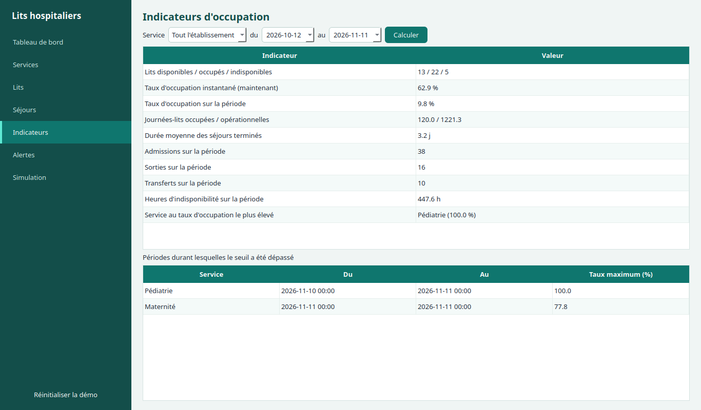
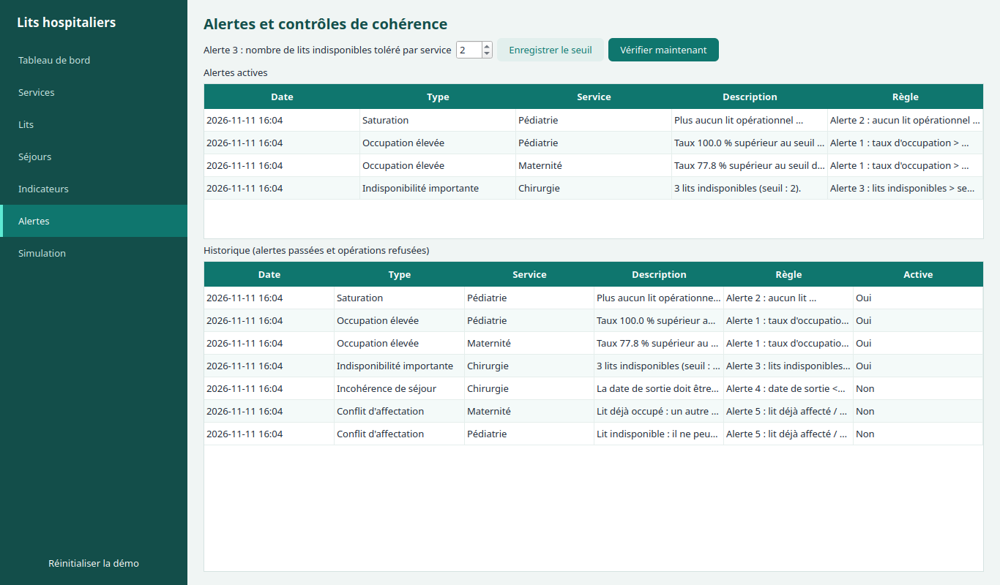
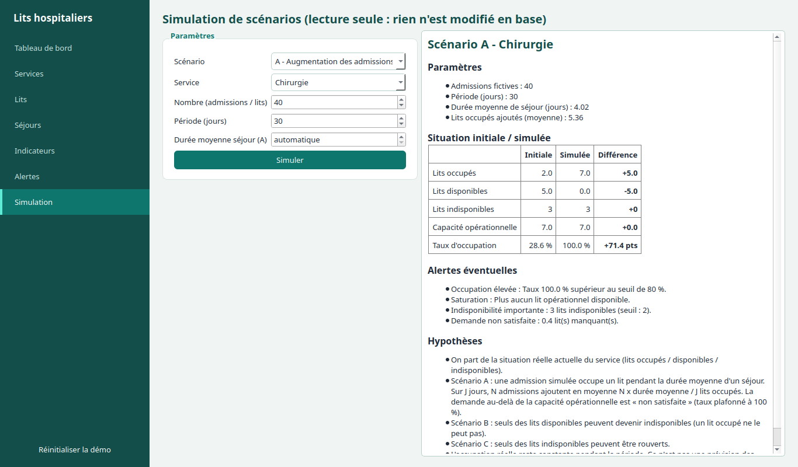

# Gestion et optimisation de l'occupation des lits hospitaliers

Application desktop Python (PyQt5 + MySQL + Matplotlib), architecture MVC. **Données 100 % fictives.**
L'outil gère et simule l'occupation des lits : il ne prend aucune décision médicale.

## Lancer

```bash
pip install -r requirements.txt          # PyQt5, matplotlib, mysql-connector-python
# MySQL doit tourner. Réglages dans config.py ou variables d'environnement :
# DB_HOST, DB_PORT, DB_USER, DB_PASSWORD, DB_NAME (défaut : hopital_lits, créée automatiquement)
python main.py                           # au 1er lancement, la démo est chargée automatiquement
python -m unittest -v                    # tests (base séparée hopital_test)
```
Le bouton **Réinitialiser la démo** (menu de gauche) recharge le jeu de données.

## Captures d'écran









## Architecture MVC : qui fait quoi ?

| Dossier | Rôle | Fichiers |
|---|---|---|
| `model/` | Accès MySQL, règles métier, calculs, alertes, simulation. **Aucun import PyQt.** | `db.py` connexion + transactions · `services.py` · `lits.py` · `sejours.py` · `stats.py` · `alertes.py` · `simulation.py` · `donnees_demo.py` · `modele.py` (façade) |
| `view/` | Fenêtres, formulaires, tableaux, graphiques. **Aucune requête SQL, aucun calcul métier.** | `fenetre.py` · `pages_gestion.py` · `pages_analyse.py` · `widgets.py` · `style.py` (couleurs) |
| `controller/` | Reçoit les clics, valide les saisies, appelle le modèle, rafraîchit la vue, gère les erreurs. | `controleur.py` |

Flux d'une action : clic → `Controleur.xxx()` → `executer()` → méthode du modèle → (`ErreurMetier` ? message d'erreur) → `rafraichir()`.

### Je veux modifier… → j'ouvre…
- une **règle métier** (ex. refuser une admission) : `model/sejours.py` ;
- une **formule** (taux, durées) : `model/stats.py` ;
- une **règle d'alerte** : `Alertes.evaluer()` dans `model/alertes.py` ;
- une **hypothèse de simulation** : `model/simulation.py` ;
- les **couleurs** : `view/style.py` ; un **champ de formulaire** : `view/pages_*.py` (+ le contrôleur) ;
- les **données de démo** : `model/donnees_demo.py` (constantes en haut du fichier).

## Base de données (`schema.sql`)
Tables : `services`, `lits`, `patients`, `sejours`, `mouvements`, `indisponibilites`, `alertes` (cahier des charges) + `parametres` (ajoutée : seuil de l'alerte 3 configurable).
Écarts justifiés : `services.nom_normalise` (unicité du nom sans accent/majuscule), `alertes.regle` et `alertes.active` (règle déclencheuse, alerte encore vraie ou non).
- Dates au format `AAAA-MM-JJ HH:MM:SS` ; requêtes toujours **paramétrées** (`%s`) ; chaque opération à plusieurs écritures = **transaction** (`with db.transaction():`).
- Le lit d'un séjour est dans `mouvements` : un transfert ferme l'affectation (`date_fin`) et en ouvre une autre (`Transfert`) ; la sortie ajoute un repère `Sortie` (début = fin). L'état du lit (`lits.etat`) est **toujours recalculé** depuis les mouvements ouverts et les indisponibilités par `Lits.maj_etat()`.
- **Double sécurité contre la double occupation** : vérification dans le code *et* index `UNIQUE` sur une colonne calculée (`mouvements.lit_occupe`, `sejours.patient_en_cours`) : même un bug Python ne pourrait pas affecter 2 séjours au même lit.
- Aucune suppression physique : services et lits se désactivent / se rendent indisponibles, l'historique reste.

## Conventions de calcul (documentées dans `model/stats.py`)
- Durées calculées en **heures**, **journée-lit = 24 h**. Un séjour ou une indisponibilité couvre `[début, fin[` ; sans fin = jusqu'à la fin de la période.
- **Taux instantané** = occupés / (occupés + disponibles) × 100 ; les indisponibles sont hors dénominateur ; dénominateur nul → **« Non calculable »**.
- **Taux sur période** = journées-lits occupées / journées-lits opérationnelles × 100 (opérationnelles = lits × jours − journées d'indisponibilité).
- **Durée moyenne** = moyenne des séjours **terminés** (en jours). Courbe d'évolution : taux à 12:00 chaque jour.
- Les dates d'admission, sortie et transfert ne peuvent pas être dans le futur (l'état « actuel » des lits reste ainsi cohérent).

## Alertes
1 Occupation élevée (taux > seuil du service) · 2 Saturation (aucun lit disponible, au moins un occupé) · 3 Indisponibilité importante (> seuil configurable, onglet Alertes) · 4 Incohérence de séjour (sortie ≤ admission) · 5 Conflit d'affectation (lit occupé/indisponible, patient déjà hospitalisé).
Les alertes 1-3 sont calculées puis enregistrées (active tant que la condition est vraie) ; les refus 4-5 sont journalisés dans l'historique.

## Simulation (lecture seule)
Hypothèses affichées avec chaque résultat (`HYPOTHESES` dans `model/simulation.py`). Scénario A : N admissions fictives occupent chacune un lit pendant la durée moyenne de séjour → lits occupés ajoutés = N × durée moyenne / jours de la période ; la demande au-delà de la capacité est comptée « non satisfaite » (taux plafonné à 100 %). B : seuls des lits *disponibles* peuvent être fermés. C : seuls des lits *indisponibles* peuvent être rouverts. Aucune écriture en base (test T14).

## Jeu de données de démonstration
4 services · 40 lits · 30 patients · 38 séjours (16 terminés, 22 en cours) · 10 transferts · 7 indisponibilités · 3 tentatives invalides refusées et journalisées. Cas couverts : Chirurgie à faible occupation (29 %), Pédiatrie saturée (100 %), Maternité au-dessus de son seuil, 3 lits indisponibles en Chirurgie (alerte 3).

## Tests (`tests/test_hopital.py`, 30 tests, tous réussis)
| N° | Test | Résultat attendu | Obtenu |
|---|---|---|---|
| T1 | Service valide | Service enregistré | ✅ `test_T1_service_valide` |
| T2 | Même nom (même normalisé) | 2ᵉ création refusée | ✅ `test_T2_nom_deja_utilise` |
| T3 | Code de lit existant | Refusé | ✅ `test_T3_code_lit_existant` |
| T4 | Admission, lit disponible | Séjour créé, lit occupé | ✅ `test_T4_admission_lit_disponible` |
| T5 | Admission, lit indisponible | Refusé | ✅ `test_T5_admission_lit_indisponible` |
| T6 | Admission, lit occupé | Refusé | ✅ `test_T6_admission_lit_occupe` |
| T7 | Sortie avant (ou à) l'admission | Refusé | ✅ `test_T7_sortie_avant_admission` |
| T8 | Sortie d'un séjour en cours | Terminé, lit libéré | ✅ `test_T8_sortie_libere_le_lit` |
| T9 | Transfert, lit disponible | Mouvement enregistré | ✅ `test_T9_transfert_lit_disponible` |
| T10 | Transfert, lit occupé | Refusé | ✅ `test_T10_transfert_lit_occupe` |
| T11 | Base sans séjour | Résultat défini, sans erreur | ✅ `test_T11_base_sans_sejour` |
| T12 | Aucun lit opérationnel | « Non calculable » | ✅ `test_T12_aucun_lit_operationnel` |
| T13 | Dépassement du seuil | Alerte générée | ✅ `test_T13_depassement_du_seuil` |
| T14 | Simulation d'indisponibilité | Capacité recalculée, données intactes | ✅ `test_T14_simulation_sans_modification` |
| T15 | Échec d'un transfert | Données initiales conservées (rollback) | ✅ `test_T15_echec_transfert_conserve_les_donnees` |

Tests en plus : patient déjà hospitalisé, service désactivé, lit occupé non déclarable indisponible, garde-fou MySQL, taux sur période, durée moyenne, compteurs, saturation, alerte 3, journal des refus, simulations A/B.

## Déclaration d'usage de l'IA (à relire et compléter par l'étudiant)
- **Outil** : assistant de programmation Claude Code (Anthropic).
- **Tâches concernées** : conception du schéma MySQL, génération de tout le code Python (modèle, vue, contrôleur), des tests T1-T15 et de ce document.
- **Suggestions retenues** : transactions + verrouillage `SELECT … FOR UPDATE` ; index `UNIQUE` sur colonnes calculées comme garde-fou ; recalcul de l'état des lits depuis l'historique ; simulation en lecture seule avec hypothèses affichées.
- **Vérifications réalisées** : 30 tests automatiques passés sur MySQL 8.4 ; lancement de l'interface et parcours des 7 pages ; relecture statique (pyflakes). **À faire par l'étudiant** : relire chaque module, rejouer les tests et la démo, être capable d'expliquer et de modifier `sejours.py`, `stats.py` et `alertes.py`.
